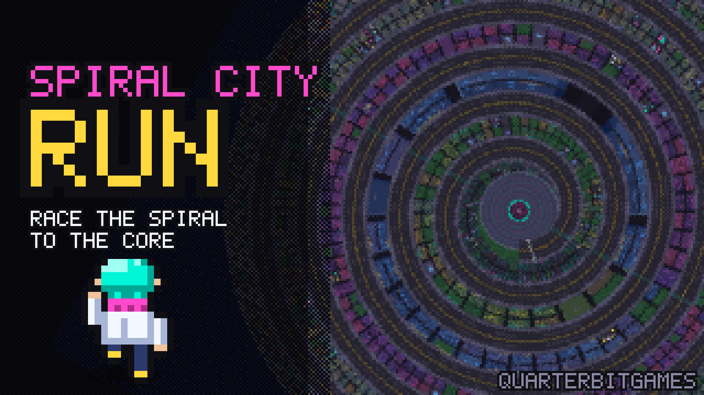

# Spiral City Run

*A QuarterbitGames original.*

Spiral City is one road that winds inward, lap after lap, to the Core at its heart.
Sky has to get there before the clock runs out.

It's a top-down 16-bit runner in the style of the SNES. The city turns under Sky the way
Mode 7 games did, so she always runs straight up the screen while the turns get tighter
the deeper she goes.

## How to play

- **Sky runs on her own.** You steer her across the four lanes, dash, and jump.
- **Beat the clock.** Every half lap there's a **checkpoint** that adds time. Reach the
  **GOAL** before the clock hits zero.
- **Dash** to go faster. It drains the DASH meter, which refills when you stop. Run it
  dry and Sky is tired for a moment.
- **Hover cars** come at you in the left lanes, headlights first. Slower cars in the
  right lanes block your way, and later on they change lanes (watch the blinkers).
- **Barriers:** go through the gap, or jump them when they cover the whole road.
  Pink sparks float above full barriers and are only reachable mid-jump.
- **Cones** slow you down. **Glitch puddles** make you skid. **Boost pads** launch you.
- **Sparks** are your score (pink ones are worth 5). Taking a hit drops a few.
- A rare **clock** gives +2 seconds.

Each lap is a new district: Outer Docks, Neon Market, Signal Heights, Bloom Gardens,
The Coil, and finally The Core. Finish to get a rank (S, A, B or C). Your best time is saved.

## Controls

| Action | Gamepad | Keyboard |
|---|---|---|
| Steer | Left stick / D-pad | Arrows / WASD |
| Jump | A or B | Space / J / Z |
| Dash (hold) | X / Y / RB / RT, or push up | Shift / K / X, or Up |
| Slow down | LB / LT, or pull down | Down / S |
| Pause | Start | Esc / P |
| Music on/off | Select / Back | M |
| Menus | Stick / D-pad + A | Arrows + Enter |

You get rumble on hits if your controller supports it.

## Under the hood

It's one file, `index.html`, with no build step and no assets to load. Everything is
generated in code when the page opens:

- **The city map** (2656x2656 pixels) is painted pixel by pixel from spiral math: lanes,
  streetlight pools with ordered dithering, rooftops with neon signs, parks, helipads,
  the docks and bay, and the Core plaza.
- **The camera** rotates and draws that map at a real SNES resolution of 256x224, then
  stretches it to 4:3 like a TV did.
- **Sprites** (Sky, hover cars, props) and the 5x7 pixel font are built from small tables.
- **The music** is an original 8-bar theme played by a tiny Web Audio band: a pulse
  lead with SNES-style echo, arpeggios, triangle bass and noise drums. It speeds up in
  the last 10 seconds.

The clock was tuned with a bot that played full runs. A good
dasher finishes with about 20 seconds to spare. A careful runner who never dashes
only just makes it, or doesn't.

Saved in localStorage: `scr_best` (best time) and `scr_music` (music on/off).

## Run it

Open `index.html` in a browser, or serve the folder with `python3 -m http.server 8000`
and go to http://localhost:8000. It's also playable at
[spiralside.com/games/spiral-city-run](https://www.spiralside.com/games/spiral-city-run/).
